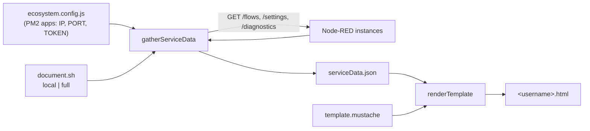

# pi-documentation

A command-line tool that generates an HTML documentation page for every Node-RED instance on a host by querying each instance's admin API.


## Demo

<!-- TODO: demo link or video -->

## Overview

When several Node-RED services run side by side under PM2, there is no single place to see what each one is running. This tool reads the PM2 `ecosystem.config.js`, calls the admin API of every service listed in it, and writes one HTML page per user. The page lists each service's IP, port, Node-RED version and Node.js version, plus every flow and subflow with its status and the notes written in its info field.

## Key features

- Discovers services from a PM2 `ecosystem.config.js` instead of a hand-maintained list. Each app's `env` supplies `IP` (defaults to `localhost`), `PORT` and `TOKEN`.
- Calls `/flows`, `/settings` and `/diagnostics` for each service in parallel with a bearer token.
- Lists only tabs and subflows, marks disabled flows, and pulls in each flow's info text as its description.
- Skips services with no port or token, and keeps going when one service is unreachable, so one bad instance doesn't block the rest.
- `full` mode documents separate dev, test and prod instances in one run, running each as its own system user (`nodereddev`, `noderedtest`, `noderedprod`) through `sudo -u`.

## Tech stack

| Area | Tools |
|---|---|
| Runtime | Node.js |
| HTTP | axios |
| Templating | Mustache |
| Wrapper | Bash (`document.sh`) |
| Target | Node-RED admin HTTP API, PM2 ecosystem files |

## Architecture

The tool runs in two steps. `gatherServiceData` collects data from every service and writes it to `serviceData.json`. `renderTemplate` then fills `template.mustache` with that JSON and writes `<username>.html`. Keeping the JSON on disk means the raw data can be checked separately from the rendered page.



## Technical highlights

- The three API calls per service go out together with `Promise.all`, and services are handled one after another inside a `try/catch`. A failed service is logged and left off the page, and the rest still render.
- In `full` mode the script runs once per environment as that environment's system user, so dev, test and prod each get their own page from their own ecosystem file.

## Getting started

Requires Node.js and network access to the Node-RED instances. Each app in `ecosystem.config.js` needs `PORT` and `TOKEN` (a Node-RED admin API bearer token) in its `env` block, and can set `IP`.

```js
// ecosystem.config.js
module.exports = {
  apps: [
    { name: 'flows-dev', env: { IP: 'localhost', PORT: 1880, TOKEN: '<admin token>' } },
  ],
};
```

Install and run from the repo root. The script reads `template.mustache` and writes its output in the current directory.

```sh
npm install

# one user, one ecosystem file
./document.sh local <username> <path/to/ecosystem.config.js>

# dev, test and prod instances, each run as its own system user
./document.sh full <dev ecosystem.config.js> <test ecosystem.config.js> <prod ecosystem.config.js>
```

You can also call the script directly with `node nodeRedDocumentation.js <username> <path/to/ecosystem.config.js>`. Output is `serviceData.json` and `<username>.html`.

## License

MIT
